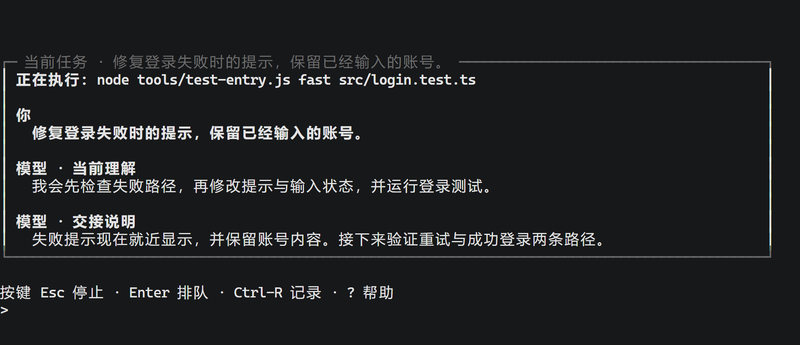
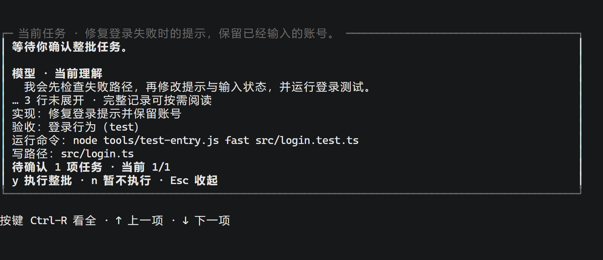
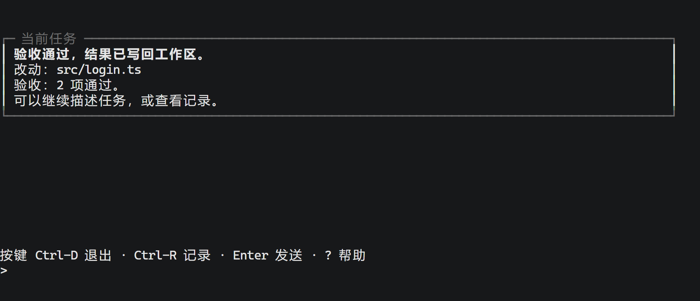

# 赋格 _(fugue)_

<p align="center">
  <picture>
    <source media="(prefers-color-scheme: dark)" srcset="assets/brand/fugue-lockup-inv.svg">
    
  </picture>
</p>

[](https://github.com/54shitaimzf/Fugue/actions/workflows/test.yml?query=branch%3Amain)

赋格是一个在终端里用的编程助手。你告诉它想做什么，它会先和你把需求聊清楚，然后自己拆分任务、写代码、跑测试。

它最重要的一个特点是：**测试没全部通过之前，它不会碰你的文件。** 中途失败了，你的项目还是原来的样子，不会留下改了一半的代码。

## 它怎么工作

假设你对它说：

> 把记账模块补完：金额按分格式化、加一个 `avg`、删掉过时的旧文件。

它会按下面五步来做。每一步结束时你都能看到它做了什么。

1. **聊需求。** 它会读你的项目（代码、提交历史、项目里写的规范），有不清楚的地方就问你。这一步只读不写。聊得差不多了，你可以运行 `fugue round plan <目标>`，或者直接在对话里说「可以开始了」，它能听懂。
2. **拆任务。** 它把目标拆成几个能独立完成的小任务，每个都写明要交付什么、会改哪些文件、怎样算做完。拆完后它会停下来，等你确认。
3. **写代码。** 你确认之后（运行 `fugue round go`），每个小任务在各自的隔离目录里进行，互不影响。这段时间你的项目文件完全不会被改动。
4. **跑检查。** 所有小任务做完后，它把结果合并起来，运行事先定好的检查。没通过就让对应的任务重做；重做还不过，就放弃这一轮。
5. **写回项目。** 检查全部通过后，它才生成一个 git 提交，并把改动写回你的项目。只要中间任何一步失败，你的文件就保持原样，也不会留下多余的分支。

它做的每一件事都会记在项目的 `.fugue/` 目录里。这份记录只会往后追加，不会被修改，所以你随时可以查它现在在干什么、上一次为什么停下。

还有一点：**它不会覆盖你自己手动改过的文件。** 写回之前，它会检查项目里有没有既不是你原来的版本、也不是它这次生成的改动。如果有，它会一条条列出来，而不是直接覆盖。

## 安装

你需要准备：

- **Linux 或 WSL2。** 项目要放在 ext4 这类 Linux 原生文件系统上，Windows 的 NTFS 分区不行。
- **Node 22.6 或更高版本。** 它直接运行 `.ts` 文件，不需要编译。
- **git 2.38 或更高版本。**

```sh
git clone https://github.com/54shitaimzf/Fugue.git ~/fugue && cd ~/fugue
ln -s "$PWD/bin/fugue" ~/.local/bin/fugue      # 或者用 npm i -g .
fugue --help                                   # 命令速查表：每条命令带一两句说明
```

它没有任何第三方依赖，`package.json` 里的 `dependencies` 是空的，所以不用 `npm install`。

要连接真实的大模型，你需要一个 API 密钥。配置里保存的是「密钥放在哪里」（环境变量名或密钥文件路径），密钥本身不会写进配置、日志或它生成的任何文件。在系统级配置里配一张查找表，整台机器配一次：

```sh
fugue config set --system credentials.deepseek \
  '[{"from":"env","name":"DEEPSEEK_API_KEY"},{"from":"file","path":"<密钥文件的路径>"}]'
```

用的时候它按这张表逐条找：先看环境变量 `DEEPSEEK_API_KEY`，没有再读那份文件。临时换一份密钥文件，运行时给 `--credential <文件路径>`：没配过表的，这一条自己就是一条路；配过表的，它换掉表里的文件那一栏（环境变量那一栏仍排在前面）。什么都没配时它会当场报错，并把上面这条配法原样告诉你。

模型列表和价格放在全局配置目录 `~/.fugue/` 里。如果你创建了 `~/.fugue/models.json`，它会完全替换掉内置的模型列表。每个项目自己的配置只会覆盖它写了的那几项，其他的沿用全局设置。

## 先试一下（不联网、不花钱，半分钟跑完）

下面这条命令用的是**提前录好的真实模型回复**，不需要 API 密钥，任何人都能直接跑：

```sh
git clone https://github.com/54shitaimzf/Fugue.git fugue && cd fugue
sh tools/live-round.sh src/cli/__fixture__/wire-in/scenario.json \
   --wire-in src/cli/__fixture__/wire-in/wire
```

它会现场新建一个 git 仓库，完整跑一遍流程，然后把结果放在 `/tmp/live-w11-out/` 目录下，包括 `before.txt`、`run.log`、`after.txt`、`watch.log` 和 `wire/`。

下面是 `run.log` 开头那一段的实际输出（后面还有打回统计、归因对照、逐趟账和八元指标）：

```text
漂移检：HEAD 没动 · 这次合并动到 [notes.md] · 盘上与目标树不同 [] · 会被覆盖的（盘上既不是底也不是目标树）[（没有）]
  任务 1 份：r1.implement.1
  预检：准备计划 0 对 · 合并前 0 对
  折叠：折了 0 步
  验收：通过 2 · 没通过 0 · 跑不起来 0
  推进：写 1 条 · 删 0 条 · 跳过 2 条
  停因：agent/r1/1 3 步 · 收敛
  合计 调用 3 · input 2762 · cacheRead 4992 · cacheWrite 0 · output 140 · 思考 0（缺 3 条） · 费用 ≈ $0.000513
```

注意 `cacheRead 4992` 比 `input 2762` 还多，说明大部分内容都命中了缓存，这就是它省钱的原因。它发给模型的内容分成三段：项目背景、当前任务说明、当前这一步的进展。前两段在每一步之间基本不变，只有第三段在增长。所以在这次运行里，第 2 步只需要多发 150 个 token。

（每次运行生成的提交哈希都不一样，因为仓库是现场新建的。）

## 使用方法

### 先聊清楚需求

开始干活之前，你可以先和它聊几句。聊天内容会原样保存到 `.fugue/session/`，之后拆任务时它会参考这些内容：

```sh
fugue say "记账模块先只做金额格式化，avg 那一条先别动"     # 默认调用真实模型，会产生费用
fugue say "旧文件先留着，别删"
```

什么时候从聊天进入拆任务，由你决定：运行 `fugue round plan <目标>`，或者在对话里说「可以开始了」。每一轮任务默认叫 `r1`，想改名可以用 `fugue config set round.id <名字>`。

### 在自己的项目里用

在**你自己的项目**里（必须是 git 仓库）运行：

```sh
cd <你的项目>
echo .fugue/ >> .git/info/exclude         # 它的工作记录放在 .fugue/ 里，别让这个目录进入你的提交

# 第一步：告诉它用什么命令判断「做对了」。它不会自己猜，你要给检查起个名字，再绑定一条命令
fugue config set actions.test '{"argv":["/bin/sh","-c","npm test"]}'
fugue config set round.id r1              # 给这一轮任务起个名字

# 第二步：把目标交给它。--live 表示调用真实模型，会产生费用。第一次用建议把步数上限设小一点
fugue round plan "把记账模块补完：金额按分格式化 · 加一个 avg · 删掉过时的旧文件" --live --max-steps 8

# 第三步：看它拆出来的任务列表（这时它在等你，还没改任何文件），没问题就确认
fugue round go

# 第四步：让它把任务做完（要跑哪些检查写在任务列表里，具体命令就是第一步绑定的那条）
fugue round work --live --max-steps 8
```

如果你想自己决定怎么拆任务，而不是让它来拆：先用 `fugue config set round.split '[…]'` 和 `fugue config set round.assertions '[…]'` 写好任务和检查，再运行 `fugue round run "<目标>" --live`，一条命令从头跑到尾。

想知道配置认得的顶层键有哪些，用 `fugue config ls`：一行一个键，`--json` 那一面是数组。它不读你的配置，所以配置有毛病的时候它照样答得出；要看当下配了什么，用 `fugue config show`。

**费用参考：** 一次真实任务按 2 个子任务、每个最多 64 步来估算，大概花几毛钱。如果不加 `--max-steps`，就没有步数限制。要不要设上限、设多少，由你自己决定，它不会自动帮你限制。

### 边看边操作

运行 `fugue tui`，终端底部会开出一块操作区：一块面板、一行按键提示、一行输入。面板以上是终端自己的历史，翻页、搜索、复制都和平时用终端一样。



面板正面是**当前这件事**：你说的、模型回的、它此刻真正在跑的命令、遇到什么问题、下一步做什么。你说的那句以 `>` 起行，框名固定为「当前任务」；谁说的由位置、缩进与字形分担，行首不再写「你」「模型」。计划、进展、花费这些读数在另外几面，按 `Tab` 轮换，`Alt-1` 到 `Alt-9` 直接点名。这一轮做完之后，面板里留下的是验收结果、写回情况和改了哪些文件。

按键分两处。输入行空着的时候，`/` 出命令菜单，`@` 引用文件路径，`g` 接着跑这一轮，`q` 退出；输入行上有字的时候，这几个字母就是字。`Enter` 发送，`Ctrl-J` 或 `Alt-Enter` 换行，`Esc` 一次收一样东西（收起最上面那层、停止任务、撤掉排队的下一条、清空输入），`Ctrl-R` 开阅读面看记录与文件改动全文，`?` 印出这一刻能用的键。更全的说明在 `fugue --help`。



轮次停在门口等你确认整批任务的时候（就是上面第三步），这一批要干什么、怎么验收、会改哪些文件会一并列出来：`y` 放行整批，`n` 这次不做。



两样增强档有就上、没有也不缺功能：终端认 256 色就上色，认不得退回黑白属性档，`--no-style` 或者 `NO_COLOR` 非空时全关；终端支持 Kitty 或 sixel 图形协议时，任务动过的图片能在阅读面里直接看，不支持就还是那一行文件名。

这个界面**只是用来看的**，本身不修改任何东西。在界面里按 `y`，和在命令行里运行 `fugue round go` 效果完全一样。如果输出不是终端（比如通过管道传给别的程序，或者在 CI 里运行），它会自动改成逐行打印事件，不会输出任何终端控制字符；退出之后屏幕上不留旧框。

### 查看进度

| 你想知道 | 运行这条命令 |
|---|---|
| 现在的状态：在跑哪一轮、每个子任务到哪一步了、花了多少钱 | `fugue status --once` |
| 上面的信息，再加上质量指标和打回次数统计 | `fugue status --once --metrics --report` |
| 每一笔调用的耗时与费用（模型调用 · 起进程各一行，从日志重算） | `fugue status --ledger` |
| 原始的工作记录（每行一条，不做任何处理） | `fugue log` |
| 实时跟踪进度（只读，不会影响正在运行的任务） | `fugue watch --follow` |
| 一边看一边用快捷键操作 | `fugue tui` |
| 上一次写回有没有收尾、现在该做什么 | `fugue recover`（全写回时按提示收尾：`fugue recover --finish`） |
| 清理它创建的临时工作目录 | `fugue dispose` |

任务完成后，`git status` 可能会显示很多文件有改动，这是正常的。你项目里的文件已经和它生成的提交完全一致了，只是 git 的暂存区（index）还停在旧版本。运行一次 `git reset` 就好了。它故意不去动你的暂存区。

### 等一个状态

脚本里常要等一句话：等到它开始干活，或者等到它落地。`status` 有一个等待档：

```sh
fugue status --wait Working --timeout 60
```

它每半秒看一次，等到了就印那一刻的状态、退 0；到点还没到就如实说一句、退 1——不会把超时当成成功。`--timeout` 不给就是 30 秒。状态名用 `round/state` 那一族：`Idle` · `Planning` · `Delegated` · `Working` · `Collecting` · `Merging` · `Verifying` · `Committed` · `Rebuilding` · `Aborted`。

### 写回中断以后

如果上一次写回没有收尾（进程被杀、机器断电），运行：

```sh
fugue recover
```

它只读，按账上与盘上的实际状态报“未写回 / 全写回 / 部分写回 / 冲突 / 未验证”，并给出下一步；不会自动重放写，也不会替你挪 ref。`--json` 给脚本读同一份报告。没有未收尾的发布时，它会直说没有。

判到“全写回”（文件与主线都已经到发布目标、验收已过）时，下一步会给出显式收尾：

```sh
fugue recover --finish
```

它只补落 `merge/publish done` 与 `merge/accept` 两条事实，不重放写、不碰工作树、不挪 ref；其余四态会拒绝并指回 `fugue recover`。

### 接到别的程序里

`fugue serve` 换一种进程角色：在标准输入输出上一行一次调用（JSON-RPC 2.0），把上面那张命令表里的动词原样摆给别的程序用。它是给写客户端的人用的，日常在终端里用不到；仓库里的 `tools/sample-client.mjs` 是最小样例，走一遍握手、`status` 和事件尾随。

它的寿命绑在客户端上：标准输入一断它就收尾，没人问它 30 秒它自己走——不引守护进程。一个工作区一个 serve，同时盯几个项目就开几个。

## 生成项目文档（HTML）

`fugue docs` 把这一版代码写成一套能直接打开读的 HTML 文档：给使用者、维护者和下游读者看。文档只服务阅读，不参与 agent 的任何决策，也不会被写回任何真源。

在 `.fugue/config` 里写文档定义（给谁看、讲什么、从哪来、怎么写）与整套视觉语言：

```json
{
  "docs": {
    "theme": "primer",
    "pages": [
      {
        "id": "start",
        "title": "开始",
        "source": "README.md",
        "audience": "第一次用的人",
        "role": "从安装到跑通第一条命令",
        "prompt": "先给最短路径，再给边界"
      },
      {
        "id": "api",
        "title": "接口参考",
        "source": "docs/api.md",
        "audience": "要把 Fugue 接进来的人",
        "role": "每个参数、默认值与失败行为",
        "prompt": "按查询任务组织，给出能直接跑的例子",
        "out": "api.html"
      }
    ]
  }
}
```

每条定义六栏：`id`（稳定标识，文件名与深链接都用它）· `title` · `source`（仓库里的 markdown，随提交走）· `audience`（给谁看）· `role`（负责讲什么、边界在哪）· `prompt`（这一份的写法与重点）；`out` 可选，缺省是 `<id>.html`。键名写错、路径写成绝对路径或 `..`，命令当场拒并指到该改的那一格。

```sh
fugue docs build               # 按 refs/heads/main 生成整套（收口时是刚写回的那个提交）
fugue docs build --at <提交>    # 按指定提交重建（定义与主题取今天的工作区配置）
fugue docs build --theme govuk  # 只换一套视觉语言
fugue docs status               # 现有产物对应哪一版 · 最近一次生成成没成
fugue docs prompt start         # 打出这一份的实际写作输入，不调模型
```

产物在 `.fugue/docs/`：`index.html` 是入口，浏览器直接打开就行（`file://` 可用，不用起服务）。每一页自包含：样式、脚本与查找索引都在页面里，本地图片复制进 `_assets/`；关掉 JavaScript 后正文、目录、原生展开与标签切换仍可读，查找退到浏览器自带的查找。

**视觉语言是整套换的**：`theme` 取 `primer`（GitHub Primer）· `carbon`（IBM Carbon）· `material3`（Material 3）· `govuk`（GOV.UK Design System）之一。换主题只换呈现，内容与操作含义不变；主题的视觉规则也会进写作输入，所以模型会按那一套规范组织页面。

**一次生成是两趟调用**：先让模型点名要读哪几份仓库文件，再把那几份原文、来源与提交事实一起给它写正文。用量、逐页取证与页面清单记在 `.fugue/docs/manifest.json`；最近一次生成成没成记在 `last.json`，`docs status` 把这两件事分开报。

**失败不毁旧版**：新批次全部生成并通过校验才替换；中断或失败时，旧页面、旧资源与旧清单原样留着，下一步照样能读。`round run` / `round work` 通过验收后会自动生成一次（打桩与回放两档不出网，不生成）。

页面因为输出预算被截断时，抬一下单页预算：`fugue config set docs.maxTokens 65536`，再生成一次。

生成之后想自己核对一遍形状（清单与实际文件对不对得上 · 内部链接与锚点可不可达 · 查找索引落不落得到正文 · 图片地址与代码块有没有落单）：

```sh
node tools/check-docs.js            # 缺省看 <root>/.fugue/docs；显式给的目录不存在时退 2
```

## 它为什么可靠

它只以两样东西为准：**git 仓库本身**，和 **`.fugue/log/` 里的工作记录**（只追加、不修改，每行一条）。

它看到的文件内容、创建的临时目录、发给模型的内容、显示给你的各种统计，全都是从这两样东西推算出来的，不会另外保存一份。所以就算它中途停下，或者进程被杀掉后重新运行，读到的状态也是一致的。

## 目前还不支持的

- 模型不能自己再创建新的子助手。
- 只内置了一个模型 `deepseek-flash`，提供 Anthropic 和 OpenAI 两种接口格式。
- 不发布到 npm，也不允许任何运行时依赖（终端界面的显示效果都是手写的）。除了调用模型接口，它不会访问网络。
- 界面颜色只分四档（16 色 · 256 色 · 黑白属性 · 不上色），没有主题可以挑；不接管鼠标，也不能分屏。

## 更多资料

- `fugue --help`：命令速查表，每条都有一两句话说明。命令面一共 31 条（`round` 有 5 条子命令、`docs` 有 3 条、`config` 有 4 条）；命令全表在架构 § 9.6。
- 每个版本的改动：[CHANGELOG.md](CHANGELOG.md)。
- 想修改或测试赋格本身：先看 [AGENTS.md](AGENTS.md)（开发环境、怎么跑测试、演示脚本），再看 [tools/](tools/)（演示脚本、测量工具和性能测试，它们只用于开发，不属于产品）。
- 设计文档在 [design/](design/)：架构（这一版**是**什么）· 路线图（按什么次序收口）· 目标（第一版之后做什么）· 随笔（为什么这么设计）。落地计划（正在做的那一站）与归档（已经落地的那一份）随施工走，不在这个仓库里。

## 维护者

[54shitaimzf](https://github.com/54shitaimzf)（目前唯一的维护者）。

## 贡献者

- [StevenLi-phoenix](https://github.com/StevenLi-phoenix)：修复了文件权限比较的问题。以前在 `umask 002` 的机器上，没改过的文件会被误认为改过，导致任务被拒绝；软链接则在所有机器上都会被误判。这次修复还附带了四个回归测试（[#1](https://github.com/54shitaimzf/Fugue/issues/1)、[#3](https://github.com/54shitaimzf/Fugue/pull/3)）。

## 参与贡献

- 报告问题或提交修改，请使用本仓库的 Issues 和 Pull Request。
- 合并的唯一条件：`node tools/test-entry.js` 全部通过。CI 跑的也是这条命令。
- **不能添加运行时依赖，也不能增加构建步骤。** 这不是个人喜好，而是整个设计的前提：Node 要能直接运行 `.ts` 源文件。
- 动手之前，请先读 [AGENTS.md](AGENTS.md)。

## 许可证

MIT，详见 [LICENSE](LICENSE)。© 2026 54shitaimzf
